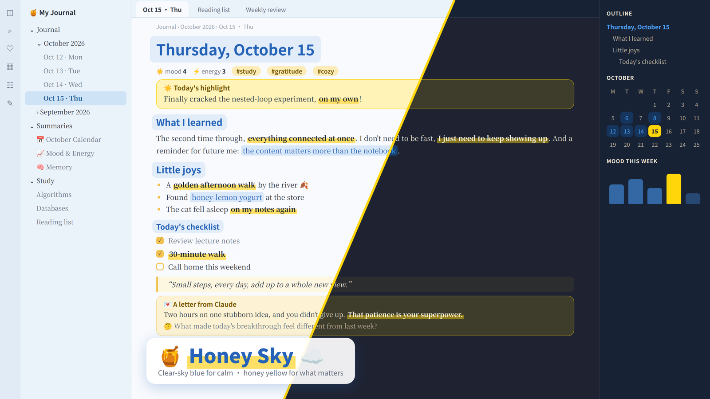
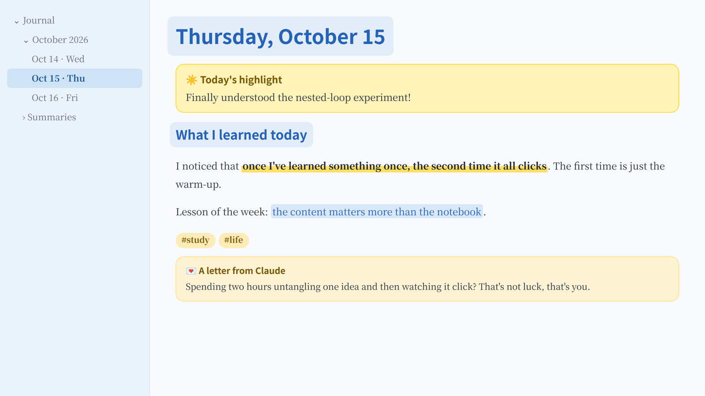
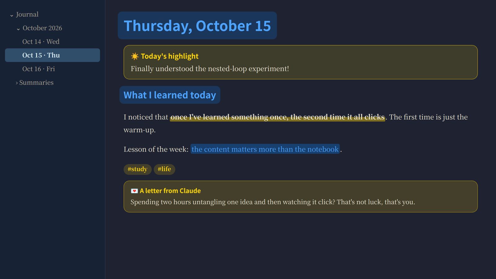

# 🍯 Honey Sky ☁️

**A blue & yellow theme for Obsidian.** Clear-sky blue for calm, honey yellow for the moments that matter.

Sky-blue paper and sidebars keep long writing sessions easy on the eyes. Bright honey yellow is saved for what you want to stand out: a highlighter stroke under your key sentences, a sticky note for the day's highlight, tags and quotes. Headings get a soft blue highlighter of their own.

[中文说明 ↓](#中文说明)







<sub>Previews are rendered mockups of the theme's colors; fonts on your Mac will look slightly different.</sub>

## The palette

| | Blue: calm | | Yellow: what matters |
|---|---|---|---|
|  | **Sky blue** `#2563B8`: headings, links |  | **Honey marker** `#FFE066`: `**bold**` becomes a highlighter stroke |
|  | **Sky highlight** `#E2EDF9`: behind headings and `==highlights==` |  | **Sunshine** `#FFD60A`: the `[!sun]` sticky note |
|  | **Sky sidebar** `#EAF2FA`: sidebars, selected file in deeper sky |  | **Honey** `#F2C14E`: tags, quotes, checkboxes, text selection |
|  | **Sky paper** `#F8FAFD`: the page |  | **Honey note** `#FFF3B8`: sticky note background |

Dark mode keeps the same idea on a warm night-navy background, with a brighter blue (`#4DA3FF`) and Apple's dark-mode yellow (`#FFD60A`).

Every text color is checked for contrast against its background. Body text is 11.8:1, headings 5:1, and the selected sidebar item 5.3:1, all above the 4.5:1 guideline for comfortable reading.

## Two highlighters and a sticky note

| You want | Write | Shortcut |
|---|---|---|
| 🟡 A **yellow highlighter** stroke | `**the sentence that matters**` | Select text, press <kbd>Cmd</kbd>+<kbd>B</kbd> |
| 🔵 A **blue highlighter** | `==something to remember==` | Select text, type `==` |
| ☀️ A **yellow sticky note** | see below | |

```markdown
> [!sun] Today's highlight
> Finally understood the nested-loop experiment!
```

A suggestion: yellow for feelings and insights, blue for facts and things you learned, and one sticky note a day for the thing that mattered most.

## Fonts

Honey Sky uses fonts that come with macOS. Headings and body text work out of the box; Kaiti SC, used for letters, may need a one-click download in Font Book.

| | English | Chinese |
|---|---|---|
| Headings | San Francisco (system) | PingFang SC 苹方 |
| Body | Baskerville | Songti SC 宋体 |
| Letters from [Journal Companion](https://github.com/florafan-cs/obsidian-journal-companion) | Baskerville | Kaiti SC 楷体 |

On Windows and Linux, it falls back to your system's sans-serif and serif fonts.

## Install

Honey Sky isn't in the community theme directory yet, so install it by hand:

1. Download [`theme.css`](theme.css) and [`manifest.json`](manifest.json).
2. In your vault, create the folder `.obsidian/themes/Honey Sky/` and put both files in it. On a Mac, press <kbd>Cmd</kbd>+<kbd>Shift</kbd>+<kbd>.</kbd> in Finder to see the hidden `.obsidian` folder.
3. In Obsidian, open **Settings → Appearance → Themes** and choose **Honey Sky**.

## Works well with Journal Companion

[Journal Companion](https://github.com/florafan-cs/obsidian-journal-companion) writes a letter back for every journal entry. Honey Sky styles those letters as honey-colored letter paper.

## License

MIT

---

## 中文说明

**Honey Sky 是一套蓝黄配色的 Obsidian 主题。** 晴空蓝负责安静，蜂蜜黄负责重点。

页面和侧栏是很浅的天蓝色，长时间写字也不累眼。明亮的蜂蜜黄只用在你想突出的地方：重点句子下面的荧光笔划线、每天的重点便签、标签和引用。标题也有一层柔和的蓝色高光。

### 两支荧光笔和一张便签

| 效果 | 写法 | 快捷键 |
|---|---|---|
| 🟡 黄色荧光笔 | `**要强调的句子**` | 选中文字按 <kbd>Cmd</kbd>+<kbd>B</kbd> |
| 🔵 蓝色荧光笔 | `==要记住的内容==` | 选中文字后输入 `==` |
| ☀️ 黄色便签 | `> [!sun] 今日重点`，下一行写 `> 内容` | |

建议这样分工：黄色标感受和领悟，蓝色标知识和要记住的事，每天只用一张黄色便签记录最重要的一件事。

### 字体

都是 Mac 自带字体：标题用苹方，正文中文用宋体、英文用 Baskerville，不用另外下载。AI 回信用的楷体，可能需要在“字体册”（Font Book）里点一下下载。

### 安装

1. 下载 [`theme.css`](theme.css) 和 [`manifest.json`](manifest.json)。
2. 在你的 vault 里新建文件夹 `.obsidian/themes/Honey Sky/`，把两个文件放进去。在 Mac 的访达里按 <kbd>Cmd</kbd>+<kbd>Shift</kbd>+<kbd>.</kbd> 可以显示隐藏的 `.obsidian` 文件夹。
3. 打开 Obsidian 的 **设置 → 外观 → 主题**，选择 **Honey Sky**。
