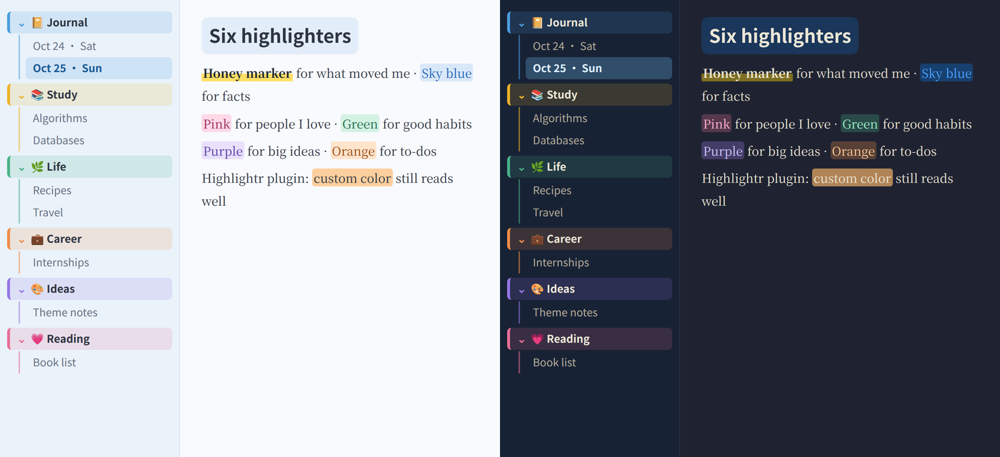
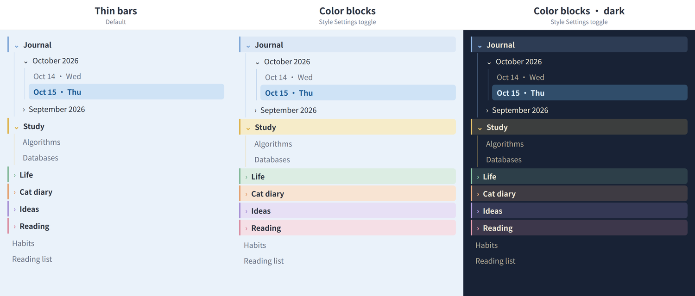

# 🍯 Honey Sky ☁️

**A blue & yellow theme for Obsidian.** Clear-sky blue for calm, honey yellow for the moments that matter.

Sky-blue paper and sidebars keep long writing sessions easy on the eyes. Bright honey yellow is saved for what you want to stand out: a highlighter stroke under your key sentences, a sticky note for the day's highlight, tags and quotes. Headings get a soft blue highlighter of their own.

[中文说明 ↓](#中文说明)


<sub>Images are rendered from the theme's own CSS on a mock workspace. Fonts on your Mac (PingFang, Songti, Baskerville) will look a little different.</sub>

## The palette

| | Blue: calm | | Yellow: what matters |
|---|---|---|---|
|  | **Sky blue** `#2563B8`: headings, links |  | **Honey marker** `#FFE066`: `**bold**` becomes a highlighter stroke |
|  | **Sky highlight** `#E2EDF9`: behind headings |  | **Sunshine** `#FFD60A`: the `[!sun]` sticky note |
|  | **Sky sidebar** `#EAF2FA`: sidebars, selected file in deeper sky |  | **Honey** `#F2C14E`: tags, quotes, checkboxes, text selection |
|  | **Sky paper** `#F8FAFD`: the page |  | **Honey note** `#FFF3B8`: sticky note background |

Dark mode keeps the same idea on a warm night-navy background, with a brighter blue (`#4DA3FF`) and Apple's dark-mode yellow (`#FFD60A`).

Every text color is checked for contrast against its background. Body text is 11.8:1, headings 5:1, and the selected sidebar item 5.3:1, all above the 4.5:1 guideline for comfortable reading.

## Two highlighters and a sticky note

| You want | Write | Shortcut |
|---|---|---|
| 🟡 A **yellow highlighter** stroke | `**the sentence that matters**` | Select text, press <kbd>Cmd</kbd>+<kbd>B</kbd> |
| 🔵 A **blue highlighter** | `==something to remember==` | Select text, type `==` |
| ☀️ A **yellow sticky note** | see below | |

```markdown
> [!sun] Today's highlight
> Finally understood the nested-loop experiment!
```

A suggestion: yellow for feelings and insights, blue for facts and things you learned, and one sticky note a day for the thing that mattered most.

## Rainbow folders and paper highlighters



**Rainbow folders.** Each top-level folder in the sidebar gets a quiet, muted color: misty blue, honey, sage, apricot, lilac, dusty rose, repeating in order. It shows as a thin bar, a colored arrow and matching indent guides, so the sidebar stays calm.



With the [Style Settings](https://github.com/mgmeyers/obsidian-style-settings) plugin you can switch on **Folder color blocks** to fill each folder title with a soft tint for clearer sections, or **Turn off rainbow folders** for a plain sky-blue sidebar.

**Paper highlighters.** Every highlight is a marker stroke across the lower part of the text, with slanted ends like a real highlighter on paper, and the text keeps its ink color. `**bold**` is honey, `==highlight==` is sky blue, and you can add:

```html
<mark class="yellow">what matters</mark>
<mark class="blue">facts to remember</mark>
<mark class="green">good habits</mark>
<mark class="mint">sparks of inspiration</mark>
<mark class="orange">to-dos</mark>
<mark class="purple">big ideas</mark>
<mark class="pink">people I love</mark>
```

Using the [Highlightr](https://github.com/chetachiezikeuzor/Highlightr-Plugin) plugin? Its colors work too, with rounded corners and readable text.

## Fonts

Honey Sky uses fonts that come with macOS. Headings and body text work out of the box; Kaiti SC, used for letters, may need a one-click download in Font Book.

| | English | Chinese |
|---|---|---|
| Headings | San Francisco (system) | PingFang SC 苹方 |
| Body | Baskerville | Songti SC 宋体 |
| Letters from [Journal Companion](https://github.com/florafan-cs/obsidian-journal-companion) | Baskerville | Kaiti SC 楷体 |

On Windows and Linux, it falls back to your system's sans-serif and serif fonts.

## Install

Honey Sky isn't in the community theme directory yet, so install it by hand:

1. Download [`theme.css`](theme.css) and [`manifest.json`](manifest.json).
2. In your vault, create the folder `.obsidian/themes/Honey Sky/` and put both files in it. On a Mac, press <kbd>Cmd</kbd>+<kbd>Shift</kbd>+<kbd>.</kbd> in Finder to see the hidden `.obsidian` folder.
3. In Obsidian, open **Settings → Appearance → Themes** and choose **Honey Sky**.

## Works well with Journal Companion

[Journal Companion](https://github.com/florafan-cs/obsidian-journal-companion) writes a letter back for every journal entry. Honey Sky styles those letters as honey-colored letter paper.

## License

MIT

---

## 中文说明

**Honey Sky 是一套蓝黄配色的 Obsidian 主题。** 晴空蓝负责安静，蜂蜜黄负责重点。

页面和侧栏是很浅的天蓝色，长时间写字也不累眼。明亮的蜂蜜黄只用在你想突出的地方：重点句子下面的荧光笔划线、每天的重点便签、标签和引用。标题也有一层柔和的蓝色高光。

### 两支荧光笔和一张便签

| 效果 | 写法 | 快捷键 |
|---|---|---|
| 🟡 黄色荧光笔 | `**要强调的句子**` | 选中文字按 <kbd>Cmd</kbd>+<kbd>B</kbd> |
| 🔵 蓝色荧光笔 | `==要记住的内容==` | 选中文字后输入 `==` |
| ☀️ 黄色便签 | `> [!sun] 今日重点`，下一行写 `> 内容` | |

建议这样分工：黄色标感受和领悟，蓝色标知识和要记住的事，每天只用一张黄色便签记录最重要的一件事。

### 彩虹文件夹和纸质荧光笔

**彩虹文件夹**：侧栏里每个顶层文件夹会依次用一种柔和的莫兰迪色：雾蓝、蜂蜜、鼠尾草绿、杏色、丁香紫、玫瑰灰，循环使用。只显示一道细色条、彩色小箭头和同色的缩进线，侧栏依然安静。安装 Style Settings 插件后，可以打开 **Folder color blocks**，让每个文件夹标题铺上一层柔和色块，分区更清楚；也可以打开 **Turn off rainbow folders**，让侧栏回到纯天蓝。

**纸质荧光笔**：所有高亮都像在纸上用荧光笔划过，只涂文字下半截，两端微微斜切，字保持原来的墨色。加粗是蜂蜜黄，`==高亮==` 是天蓝，还可以这样写：

```html
<mark class="yellow">黄色：重点</mark>
<mark class="blue">蓝色：知识点</mark>
<mark class="green">绿色：好习惯</mark>
<mark class="mint">薄荷：灵感</mark>
<mark class="orange">橙色：待办</mark>
<mark class="purple">紫色：大想法</mark>
<mark class="pink">粉色：重要的人</mark>
```

用 Highlightr 插件选的颜色也能正常显示。

### 字体

都是 Mac 自带字体：标题用苹方，正文中文用宋体、英文用 Baskerville，不用另外下载。AI 回信用的楷体，可能需要在“字体册”（Font Book）里点一下下载。

### 安装

1. 下载 [`theme.css`](theme.css) 和 [`manifest.json`](manifest.json)。
2. 在你的 vault 里新建文件夹 `.obsidian/themes/Honey Sky/`，把两个文件放进去。在 Mac 的访达里按 <kbd>Cmd</kbd>+<kbd>Shift</kbd>+<kbd>.</kbd> 可以显示隐藏的 `.obsidian` 文件夹。
3. 打开 Obsidian 的 **设置 → 外观 → 主题**，选择 **Honey Sky**。
